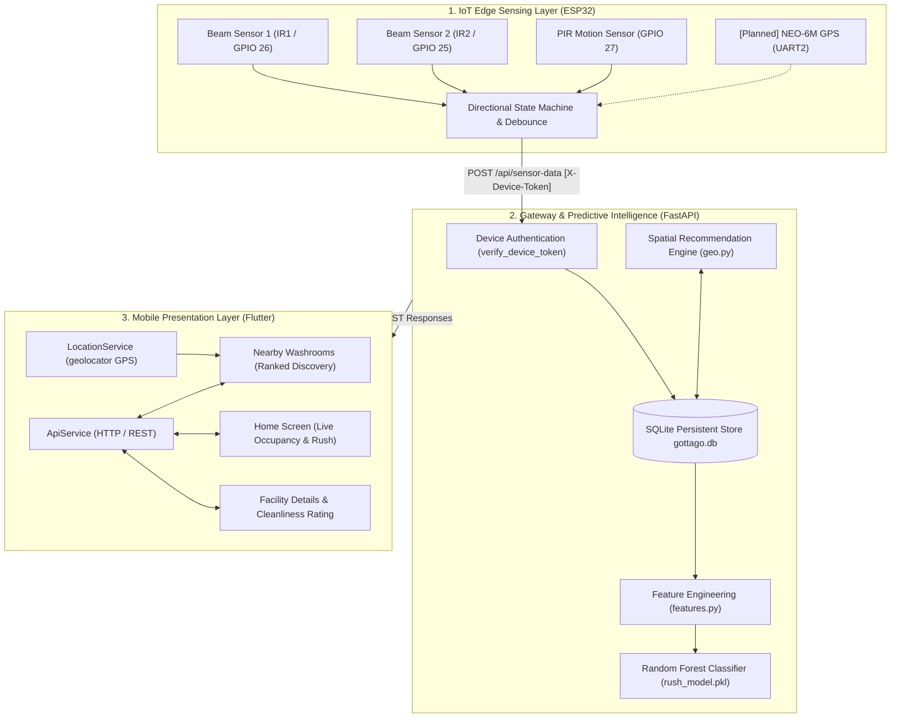
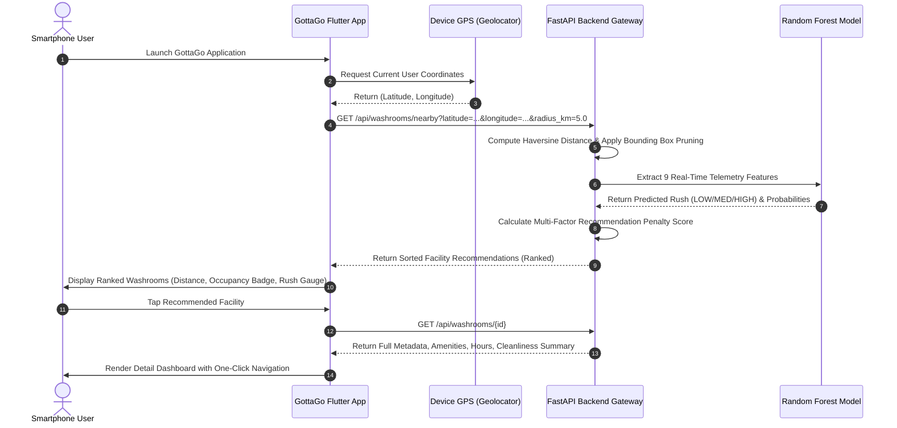
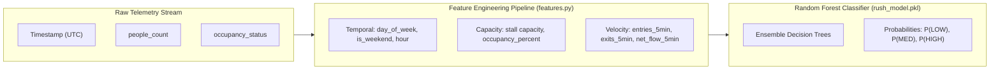

# 🚽 GottaGo — Smart Public Washroom Discovery, Real-Time Occupancy & AI Rush Prediction Platform

**A Cyber-Physical System & Machine Learning Capstone Project**
*Bachelor of Technology (B.Tech) in Artificial Intelligence & Data Science*
GitHub Repository: https://github.com/sakshe2012/GottaGo

---

## 1. Project Overview & Motivation

### 1.1 The Urban Sanitation Challenge
Access to clean, accessible, and uncrowded public sanitation is a persistent challenge in dense urban centers, transit terminals, educational campuses, and commercial hubs:
- **Zero Real-Time Visibility**: Users have no prior insight into whether a facility is currently vacant, occupied, or experiencing peak congestion, resulting in wasted transit time and frustrating queues.
- **Queue Unpredictability**: Facility rush levels fluctuate rapidly based on time of day, day of week, and sudden crowd surges, which static schedule boards cannot convey.
- **Accessibility Barriers**: Individuals requiring wheelchair-accessible facilities or specific gender accommodations frequently navigate blind to facilities that cannot serve their needs.
- **Inefficient Facility Utilization**: Lack of distribution intelligence leaves certain restrooms severely overburdened while adjacent facilities sit idle.

### 1.2 Proposed Cyber-Physical Solution
**GottaGo** addresses this multi-dimensional challenge through an integrated, three-tier IoT and AI platform:
1. **Edge Sensing Layer (IoT Node)**: Non-intrusive directional infrared (IR) beam-break sensors and passive infrared (PIR) motion sensors deployed at facility entrances perform autonomous, real-time bidirectional occupant counting without capturing personally identifiable imagery or video (ESP32 dual IR and PIR sensing is implemented; physical NEO-6M GPS firmware integration is planned).
2. **Predictive Intelligence Layer (FastAPI & Machine Learning)**: An asynchronous cloud/edge backend digests telemetry, evaluates rolling crowd velocity, extracts temporal features, and executes a pre-trained **Random Forest Classifier** to forecast rush intensity (`LOW`, `MEDIUM`, `HIGH`) with uncalibrated class-probability estimates returned by `RandomForestClassifier.predict_proba()`.
3. **Spatial Discovery & Mobile Layer (Flutter Material 3)**: A cross-platform mobile application leverages smartphone GPS, geofencing, and multi-criteria penalty scoring to dynamically recommend the optimal facility based on geodesic distance, live occupancy, predicted rush, and hardware connectivity.

---

## 2. Implemented vs. Planned Feature Matrix

To maintain strict technical integrity, the table below delineates features currently verified in the codebase versus those scheduled for future hardware and cloud phases:

| System Domain | Feature Capability | Status | Implementation Details / Source Reference |
|---|---|:---:|---|
| **Mobile Client** | Live Occupancy Display | **Implemented** | Hero cards showing `VACANT` / `OCCUPIED` states & headcounts (`lib/screens/home_screen.dart`). |
| **Mobile Client** | Real-Time Rush Meter | **Implemented** | Three-tier visual gauge (`LOW`, `MEDIUM`, `HIGH`) with probability badges (`lib/widgets/rush_prediction_card.dart`). |
| **Mobile Client** | GPS Nearby Discovery | **Implemented** | Native smartphone GPS via `geolocator`, radius filtering, and permission fallbacks (`lib/screens/nearby_screen.dart`). |
| **Mobile Client** | Facility Details & Amenities | **Implemented** | Metadata, operating hours, cleanliness reviews, and directions trigger (`lib/screens/washroom_detail_screen.dart`). |
| **Machine Learning** | 9-Feature Rush Classification | **Implemented** | Scikit-learn Random Forest model (`rush_model.pkl`) executed via `model.py` and `features.py`. |
| **Machine Learning** | Stale Telemetry Protection | **Implemented** | Telemetry older than 300s triggers `prediction_status: "UNAVAILABLE"` (`features.py`). |
| **Spatial Engine** | Geodesic Proximity & Scoring | **Implemented** | Spherical Haversine distance, bounding box pruning, and additive penalty ranking ($\text{Score} = 1.0 \cdot d + 1.5 \cdot P_{\text{occ}} + 1.0 \cdot P_{\text{rush}} + 0.5 \cdot P_{\text{conn}}$, sorted ascending where lower is better; `geo.py`). |
| **Backend & Security** | Token Device Authentication | **Implemented** | Fail-closed `X-Device-Token` validation using `hmac.compare_digest` (`backend/main.py`). |
| **Backend & Security** | Immutable GPS Registration | **Implemented** | `POST /api/devices/location` with HDOP $\le 3.5$, satellites $\ge 4$, Null Island rejection (`models.py`). |
| **Edge Hardware** | Directional People Counting | **Implemented** | ESP32 state machine debouncing IR1 (GPIO 26) and IR2 (GPIO 25) (`gottago_esp32.ino`). |
| **Edge Hardware** | PIR Presence Confirmation | **Implemented** | HC-SR501 PIR sensor on GPIO 27 with 5000ms validation window (`gottago_esp32.ino`). |
| **Edge Hardware** | Physical NEO-6M GPS Ingestion | *Planned* | Backend registration endpoint is complete; ESP32 UART2 ingestion is architected for Stage 3 Step 3. |
| **Cloud Deployment**| Managed HTTPS & CA Pinning | *Planned* | Architecture verified (`WiFiClientSecure`); public cloud domain and TLS certificate pending infrastructure rollout. |

---

## 3. End-to-End System Architecture

The GottaGo platform follows a modular, three-tier cyber-physical architecture connecting edge telemetry to cloud predictive models and mobile consumers:



---

## 4. User Workflow & Experience Journey

The diagram below maps the runtime user experience journey from opening the application to viewing live crowd forecasts and selecting an optimal facility:



---

## 5. Hardware Architecture & Edge Sensing

The physical sensing unit operates autonomously at the washroom portal, computing occupancy without capturing personal or identifiable biometric data. ESP32 dual IR beam-break counting and HC-SR501 PIR presence validation are fully implemented in firmware (`firmware/gottago_esp32/gottago_esp32.ino`), while physical NEO-6M GPS module firmware integration is planned for a subsequent update.

```
+-------------------------------------------------------------------------+
|                        FACILITY PORTAL (ENTRANCE)                       |
|                                                                         |
|     OUTSIDE                                                  INSIDE     |
|                  Beam 1 [GPIO 26]      Beam 2 [GPIO 25]                 |
|                     (IR1_PIN)             (IR2_PIN)                     |
|                        |                      |                         |
|   Direction: Entry --->|=====================>|    [PIR Motion Sensor]  |
|                        |                      |         (GPIO 27)       |
|   Direction: Exit  <---|======================|<--- Presence Validation|
|                                                                         |
+-------------------------------------------------------------------------+
```

### 5.1 Verified Component Specifications & Pinout Table
*Source: [`firmware/gottago_esp32/gottago_esp32.ino`](file:///Users/sakshisanjaykumbhar/Documents/GottaGo/firmware/gottago_esp32/gottago_esp32.ino)*

| Component | Hardware Model | ESP32 Pin | Interface / Mode | Functional Logic |
|---|---|:---:|---|---|
| **Microcontroller** | ESP32 NodeMCU (Xtensa LX6) | Core 0/1 | Dual-Core 240 MHz | Real-time state machine, Wi-Fi telemetry client. |
| **Beam Sensor 1** | Active Infrared Break-Beam | `GPIO 26` | Digital Input (Active LOW) | Outer threshold beam; triggers ingress transition. |
| **Beam Sensor 2** | Active Infrared Break-Beam | `GPIO 25` | Digital Input (Active LOW) | Inner threshold beam; confirms directional crossing. |
| **Presence Sensor** | HC-SR501 PIR Motion | `GPIO 27` | Digital Input (Active HIGH) | Confirms occupant presence inside the stall. |
| **GPS Module** | u-blox NEO-6M | `GPIO 16` *(RX2)* | HardwareSerial UART2 (9600 baud) | Fixed spatial coordinate lock (*API verified, firmware integration planned*). |

### 5.2 Directional Crossing Logic & Debouncing
- **Ingress Sequence (`ENTRY`)**: Sensor 1 triggers first (`IR1_FIRST`), followed by Sensor 2 within `CROSSING_TIMEOUT_MS` (2500 ms). Confirmed entry increments `peopleCount` by 1.
- **Egress Sequence (`EXIT`)**: Sensor 2 triggers first (`IR2_FIRST`), followed by Sensor 1 within 2500 ms. Confirmed exit decrements `peopleCount` by 1 (bounded at a non-negative floor: `peopleCount = max(0, peopleCount - 1)`).
- **Debounce Protection**: IR inputs are filtered using `IR_DEBOUNCE_MS = 40` ms; PIR motion input uses `PIR_DEBOUNCE_MS = 80` ms to prevent false re-triggers from ambient light or clothing edges.
- **Presence Validation**: A PIR motion trigger within `PIR_VALIDATION_MS = 5000` ms correlates physical activity inside the facility with beam counts, preventing ghost increments.

---

## 6. Artificial Intelligence & Data Science Pipeline

The primary analytical objective of the platform is to forecast crowd congestion before the user arrives, transforming raw event streams into actionable foresight.

### 6.1 Problem Formulation
Facility congestion is modeled as a supervised multi-class classification problem:
$$\hat{y} = f(\mathbf{x}) \in \{\text{LOW}, \text{MEDIUM}, \text{HIGH}\}$$
where $\mathbf{x} \in \mathbb{R}^9$ represents an instantaneous feature vector extracted from the historical telemetry stream.

### 6.2 The Authoritative 9-Feature Real-Time Schema
*Source: [`backend/features.py`](file:///Users/sakshisanjaykumbhar/Documents/GottaGo/backend/features.py) and [`backend/features.json`](file:///Users/sakshisanjaykumbhar/Documents/GottaGo/backend/features.json)*



| # | Feature Name | Data Type | Physical & Analytical Meaning | Mathematical Formulation |
|:---:|:---|:---:|---|---|
| 1 | `day_of_week` | Integer (`0–6`) | Day index where Monday = 0, Sunday = 6. Captures day-level usage variance. | $t_{\text{day}} \in \{0, \dots, 6\}$ |
| 2 | `is_weekend` | Binary (`0/1`) | Binary weekend flag capturing shift in public transit and campus foot traffic. | $\mathbb{I}(t_{\text{day}} \ge 5)$ |
| 3 | `hour` | Integer (`0–23`) | Hour of observation capturing diurnal peak cycles (lunch, shift end). | $t_{\text{hour}} \in \{0, \dots, 23\}$ |
| 4 | `capacity` | Integer (`\ge 1`) | Total stall capacity of the specific facility (default: 5). | $C \in \mathbb{Z}^+$ |
| 5 | `current_occupancy` | Integer (`\ge 0`) | Instantaneous headcount inside the stall from the latest sensor observation. | $N(t)$ |
| 6 | `occupancy_percent` | Float (`0.0–100.0%`) | Relative utilization ratio of the facility. | $\min\left(100.0, \frac{N(t)}{C} \times 100\right)$ |
| 7 | `entries_5min` | Integer (`\ge 0`) | Total ingress count delta over the preceding 5-minute rolling window. | $\sum_{\tau = t - 300}^t \max(0, \Delta N_\tau)$ |
| 8 | `exits_5min` | Integer (`\ge 0`) | Total egress count delta over the preceding 5-minute rolling window. | $\sum_{\tau = t - 300}^t \max(0, -\Delta N_\tau)$ |
| 9 | `net_flow_5min` | Integer | Crowd velocity indicating whether the stall is filling or emptying. | $\text{entries}_{5\min} - \text{exits}_{5\min}$ |

### 6.3 Model Architecture & Class Probability Estimates
- **Algorithm**: Scikit-Learn `RandomForestClassifier` ensemble loaded via Joblib (`rush_model.pkl`).
- **Inference Service**: `RushPredictionModelService` in `backend/model.py` loads the model once into memory on application lifespan startup.
- **Probabilistic Output**: In addition to the discrete class label (`predicted_rush`), the model returns uncalibrated class-probability estimates $P(\text{LOW})$, $P(\text{MEDIUM})$, and $P(\text{HIGH})$ computed via `RandomForestClassifier.predict_proba()` (representing relative decision tree vote fractions across the ensemble), which the mobile UI renders as proportional color meters. Post-hoc probability calibration (e.g., via `CalibratedClassifierCV` using Platt scaling or isotonic regression) is planned as a future analytical refinement.
- **Stale Telemetry Safeguard**: If no sensor telemetry has arrived within `MAX_STALE_SECONDS = 300` seconds (5 minutes), the feature extractor raises `StaleDataError`, and the API returns `prediction_status: "UNAVAILABLE"` to prevent misleading users with obsolete state.
- **Training Context**: The model was trained offline on simulation sequences modeled from temporal facility flow patterns. Continuous model refinement and field validation benchmarks will be established during extended pilot deployment.

---

## 7. Spatial Recommendation Engine & Distance Formulation

To eliminate manual searching, GottaGo computes an automated recommendation score for all active washrooms within the search perimeter.

### 7.1 Geodesic Proximity via Haversine Distance
*Source: [`backend/geo.py:26-60`](file:///Users/sakshisanjaykumbhar/Documents/GottaGo/backend/geo.py#L26-L60)*

The great-circle distance $d$ between the smartphone coordinates $(\phi_1, \lambda_1)$ and washroom coordinates $(\phi_2, \lambda_2)$ is computed using the spherical Haversine formula:
$$\Delta \phi = \text{radians}(\phi_2 - \phi_1), \quad \Delta \lambda = \text{radians}(\lambda_2 - \lambda_1)$$
$$a = \sin^2\left(\frac{\Delta \phi}{2}\right) + \cos(\text{radians}(\phi_1)) \cdot \cos(\text{radians}(\phi_2)) \cdot \sin^2\left(\frac{\Delta \lambda}{2}\right)$$
$$c = 2 \cdot \text{atan2}\left(\sqrt{a}, \sqrt{1 - a}\right)$$
$$d = R_{\text{earth}} \cdot c \quad \text{where } R_{\text{earth}} = 6371.0\text{ km}$$

### 7.2 Bounding-Box Spatial Pruning
To optimize query latency, `get_bounding_box()` in `backend/geo.py` computes a rectangular spatial envelope:
$$\Delta_{\text{lat}} = \frac{r}{111.0}, \quad \Delta_{\text{lon}} = \frac{r}{111.0 \cdot |\cos(\text{radians}(\phi))|}$$
$$\text{Box} = \left[\phi - \Delta_{\text{lat}}, \; \phi + \Delta_{\text{lat}}, \; \lambda - \Delta_{\text{lon}}, \; \lambda + \Delta_{\text{lon}}\right]$$
This allows the database to filter candidates using indexed spatial bounds before executing precise trigonometric distance calculations.

### 7.3 Multi-Criteria Recommendation Scoring Formula
*Source: [`backend/geo.py:95-157`](file:///Users/sakshisanjaykumbhar/Documents/GottaGo/backend/geo.py#L95-L157)*

GottaGo evaluates candidate washrooms using an additive **penalty score**, where a **lower score indicates a superior recommendation**:
$$\text{Score} = 1.0 \cdot d + 1.5 \cdot P_{\text{occ}} + 1.0 \cdot P_{\text{rush}} + 0.5 \cdot P_{\text{conn}}$$

Where the individual penalties are defined as:
- **Distance Penalty ($d$)**: $d = \max(0.0, \text{distance\_km})$
- **Occupancy Penalty ($P_{\text{occ}}$)**:
  $$P_{\text{occ}} = \begin{cases} 0.0 & \text{if } \text{status} = \text{"VACANT"} \\ 2.0 & \text{if } \text{status} = \text{"OCCUPIED"} \\ 0.5 & \text{if } \text{status} = \text{"UNKNOWN"} \end{cases}$$
- **Rush Level Penalty ($P_{\text{rush}}$)**:
  $$P_{\text{rush}} = \begin{cases} 0.0 & \text{if } \text{predicted\_rush} = \text{"LOW"} \\ 1.0 & \text{if } \text{predicted\_rush} = \text{"MEDIUM"} \\ 3.0 & \text{if } \text{predicted\_rush} = \text{"HIGH"} \\ 0.8 & \text{if } \text{predicted\_rush} = \text{"UNAVAILABLE"} \end{cases}$$
- **Hardware Connectivity Penalty ($P_{\text{conn}}$)**:
  $$P_{\text{conn}} = \begin{cases} 0.0 & \text{if } \text{esp32\_connected} = \text{True} \\ 0.5 & \text{if } \text{esp32\_connected} = \text{False} \end{cases}$$

Candidate washrooms are sorted in ascending order: `(recommendation_score ASC, distance_km ASC, washroom_id ASC)`. The top facility is assigned `recommendation_rank = 1`.

---

## 8. Software Architecture & Technology Stack

| Layer | Component | Technology / Library | Version / Standard | Functional Purpose |
|---|---|---|---|---|
| **Mobile Client** | Core Framework | Flutter / Dart SDK | Flutter 3.47.9 / Dart 3.13.7 | Cross-platform Material 3 user application. |
| **Mobile Client** | Device Geolocation | `geolocator` | `^13.0.2` | WGS84 GPS coordinate retrieval & permission management. |
| **Mobile Client** | OpenStreetMap | `flutter_map` / `latlong2` | `^7.0.2` / `^0.9.1` | Interactive mapping and route coordinate visualization. |
| **Mobile Client** | HTTP Networking | `http` | `^1.2.2` | Resilient JSON communication with FastAPI backend. |
| **Backend** | Web Framework | FastAPI | `>= 0.110.0` | Asynchronous high-throughput ASGI RESTful gateway. |
| **Backend** | ASGI Server | Uvicorn | `>= 0.28.0` | Production ASGI web server running with multi-worker support. |
| **Backend** | Validation Engine | Pydantic v2 | `>= 2.6.0` | Strict type enforcement and payload boundary validation. |
| **Backend** | ORM & Migrations | SQLAlchemy / Alembic | `>= 2.0.0` / `>= 1.13.0` | Relational abstraction, indexing, and schema versioning. |
| **Backend** | Database Engine | SQLite 3 | SQLite 3 (`gottago.db`) | Relational persistence preserving 1,658 production records. |
| **Machine Learning**| Model Runtime | Scikit-Learn / Joblib | `>= 1.4.0` | Ensemble Random Forest classification for crowd rush. |
| **Machine Learning**| Data Processing | Pandas / NumPy | `>= 2.2.0` / `>= 1.26.0` | Rolling temporal telemetry feature engineering. |
| **IoT Firmware** | Edge Computing | Arduino C++ / ESP-IDF | ESP32 Core `>= 2.0.0` | State machine debouncing, presence validation, HTTP client. |

---

## 9. Security Architecture & Edge Hardening

### 9.1 Fail-Closed Device Authentication (`X-Device-Token`)
All hardware telemetry ingestion (`POST /api/sensor-data`) and coordinate registration (`POST /api/devices/location`) endpoints are strictly protected:
- **Mandatory Header**: Requests must supply `X-Device-Token: YOUR_DEVICE_TOKEN`.
- **Fail-Closed Design**: If the server environment variable `LEGACY_DEVICE_TOKEN` is unset or blank, the endpoint immediately responds with `HTTP 503 Service Unavailable`, preventing unauthenticated access under misconfigured deployments.
- **Constant-Time Verification**: Verification utilizes `hmac.compare_digest` to eliminate timing side-channel vulnerabilities.
- **Unauthorized Rejection**: Missing or mismatched tokens trigger `HTTP 401 Unauthorized`.
- **Multi-Washroom Isolation**: Legacy hardware is scoped to Washroom #1. Any attempt to supply `washroom_id != 1` triggers `HTTP 403 Forbidden`.

### 9.2 Immutable Coordinate Registration Lock
To prevent malicious relocation of physical devices:
1. When a device submits GPS coordinates via `POST /api/devices/location`, the backend validates fix quality: $\text{HDOP} \le 3.5$, $\text{satellites} \ge 4$, and rejects uninitialized Null Island coordinates `(0.0, 0.0)`.
2. **First Registration**: If washroom coordinates are `NULL`, coordinates are recorded (`status: "REGISTERED"`).
3. **Immutable Lock**: Subsequent calls cannot overwrite coordinates; the backend returns the authoritative coordinates and flags `coordinates_updated: false` (`status: "ALREADY_REGISTERED"`).

---

## 10. Repository Directory Structure

```
GottaGo/
├── android/                    # Native Android host configuration (Kotlin & Gradle)
├── assets/                     # Static graphical assets & application icons
│   ├── icons/
│   └── images/
├── backend/                    # FastAPI backend & Machine Learning service
│   ├── alembic/                # Database migration environment & versions
│   ├── alembic.ini             # Alembic configuration file
│   ├── database.py             # SQLAlchemy engine, session maker, and DB init
│   ├── features.json           # 9-feature specification metadata
│   ├── features.py             # Telemetry feature extraction logic
│   ├── geo.py                  # Haversine distance, bounding box, and scoring
│   ├── gottago.db              # SQLite production database (1,658 records)
│   ├── main.py                 # FastAPI application, route handlers, and auth
│   ├── model.py                # ModelService loading rush_model.pkl
│   ├── models.py               # SQLAlchemy ORM and Pydantic validation schemas
│   ├── requirements.txt        # Backend Python dependencies
│   ├── rush_model.pkl          # Trained Random Forest classifier
│   └── test_backend.py         # 45 backend unit and integration tests
├── firmware/                   # IoT Microcontroller firmware
│   └── gottago_esp32/
│       ├── config.h            # Pinouts, Wi-Fi, and backend endpoints (Git-ignored)
│       ├── config.example.h    # Config template with safe placeholders
│       └── gottago_esp32.ino   # ESP32 sensing, counting, and telemetry sketch
├── lib/                        # Flutter cross-platform source code
│   ├── main.dart               # App entrypoint and Material 3 theme configuration
│   ├── models/                 # Domain data models (WashroomStatus, NearbyWashroom)
│   ├── screens/                # UI screens (Home, Nearby, Washroom Details, Main Nav)
│   ├── services/               # Typed API client (ApiService) and LocationService
│   ├── utils/                  # App colors, constants, and formatters
│   └── widgets/                # Reusable UI cards (Occupancy, Rush, People Count)
└── test/                       # Flutter unit, widget, and integration tests
    ├── live_integration_test.dart
    ├── nearby_discovery_test.dart
    └── widget_test.dart
```

---

## 11. Local Installation & Execution Guide

### Prerequisites
- **Python**: `>= 3.10` *(Tested on Python 3.14.6)*
- **Flutter SDK**: `>= 3.47.0` *(Tested on Flutter 3.47.9 / Dart 3.13.7)*
- **Android Studio / Android SDK**: Platform API 35 (Android 15)

---

### Step 1: Backend Setup & Server Startup

1. Open a terminal and navigate to the `backend` directory:
   ```bash
   cd backend
   ```

2. Create and activate a Python virtual environment:
   ```bash
   python3 -m venv .venv
   source .venv/bin/activate
   ```

3. Install required production dependencies:
   ```bash
   pip install -r requirements.txt
   ```

4. Configure environment variables (create `.env` from template):
   ```bash
   cp .env.example .env
   ```
   *Edit `.env` to configure your local secret device token:*
   ```ini
   HOST=0.0.0.0
   PORT=8000
   DATABASE_URL=sqlite:///./gottago.db
   ENVIRONMENT=development
   LEGACY_DEVICE_TOKEN=YOUR_SECRET_DEVICE_TOKEN
   ```

5. Launch the backend development server:
   ```bash
   uvicorn main:app --host 0.0.0.0 --port 8000 --reload
   ```
   *The server initializes the SQLite schema automatically and begins serving at `http://0.0.0.0:8000`.*

---

### Step 2: Run the Flutter Mobile Application

1. Open a second terminal session and navigate to the project root:
   ```bash
   cd ..
   ```

2. Fetch Flutter packages:
   ```bash
   flutter pub get
   ```

3. Verify codebase health and static analysis:
   ```bash
   flutter analyze
   ```

4. Launch the application on an Android emulator or connected device:
   ```bash
   flutter run
   ```

> **Android Emulator Networking**:
> The Android emulator automatically routes loopback traffic to your development computer via `http://10.0.2.2:8000`, which is pre-configured in `lib/utils/constants.dart`.

---

### Step 3: Interactive Documentation & API Reference

When the backend server is active, comprehensive interactive documentation is accessible in your web browser:
- **Interactive Swagger UI**: [http://localhost:8000/docs](http://localhost:8000/docs)
- **Detailed ReDoc Specification**: [http://localhost:8000/redoc](http://localhost:8000/redoc)
- **Backend Guide**: See [`backend/README.md`](file:///Users/sakshisanjaykumbhar/Documents/GottaGo/backend/README.md) for full endpoint request and response schemas.

---

## 12. Automated Verification & Testing

The GottaGo codebase is verified through comprehensive test suites across both the backend and mobile tiers.

### Backend Test Suite (FastAPI & ML)
Execute all 45 automated unit and integration tests using the virtual environment:
```bash
python backend/test_backend.py
```
*Last Reported Test Result:* **45 passed in 0.98s (100% passing)**
- **Tests 1–4**: Model service initialization, 9-feature schema validation, and inference.
- **Tests 5–7**: SQLite database initialization, constraints, and foreign key enforcement.
- **Tests 8–12**: Telemetry persistence, occupancy calculations, and history pagination.
- **Tests 13–14**: Real-time ML rush inference and peak rush level transitions.
- **Tests 15–18**: Multi-washroom isolation and legacy hardware device routing.
- **Tests 19–24**: Telemetry feature extraction, rolling flow metrics, and stale data handling.
- **Tests 25–35**: Haversine distance, bounding box pruning, and recommendation ranking.
- **Tests 36–43**: NEO-6M GPS registration, Null Island rejection, and immutable lock.
- **Tests 44–45**: `X-Device-Token` authentication and fail-closed `503` verification.

### Flutter Mobile Test Suite
Execute the Flutter automated widget and integration tests:
```bash
flutter test
```
*Last Reported Test Result:* **18 passed (100% passing)**
- **Widget Tests**: Home screen rendering, demo simulator state toggling, card glow rings.
- **Integration Tests**: Live API connectivity, offline fallback banner, and error state handling.
- **Discovery Tests**: GPS coordinates parsing, distance badges, and wheelchair filters.

---

## 13. Visual Demonstration & Screenshot Gallery

> 📷 **UI Demonstration Preview:**
> UI screenshots demonstrating Vacant/Occupied states, AI rush meters, and Nearby Washroom discovery are pending addition to `assets/images/` in a future update.

```
+--------------------------+  +--------------------------+  +--------------------------+
|      HOME DASHBOARD      |  |     AI RUSH METER        |  |     NEARBY DISCOVERY     |
|                          |  |                          |  |                          |
|   [ VACANT / OCCUPIED ]  |  |    Rush Level: LOW       |  |  1. Primary Washroom     |
|   People Inside: 0 / 1   |  |    [|||||||||||        ] |  |     0.05 km • Low Rush   |
|   ESP32: Connected       |  |    P(LOW)  = 85%         |  |     Score: 92.4 • Rank 1 |
|   AI Rush: Low Rush      |  |    P(MED)  = 12%         |  |  2. Library Restroom     |
|                          |  |    P(HIGH) =  3%         |  |     0.32 km • Med Rush   |
+--------------------------+  +--------------------------+  +--------------------------+
```

---

## 14. Current Implementation Limitations

To maintain academic and professional transparency, the current operational boundaries are documented below:
1. **Single-Facility Hardware Scoping**: Physical telemetry is currently mapped to primary legacy hardware (Washroom #1). Multi-washroom scaling is architected in software but requires additional provisioned microcontrollers.
2. **Local Relational Database**: SQLite provides zero-configuration local storage suitable for prototyping; high-concurrency multi-city deployments will benefit from migration to PostgreSQL / TimescaleDB.
3. **Local HTTP Telemetry**: Physical ESP32 firmware currently communicates over local Wi-Fi HTTP; production cloud deployment requires flashing the verified `WiFiClientSecure` TLS root CA certificate.
4. **Physical GPS Ingestion**: The backend GPS registration API contract is fully tested; flashing the corresponding UART2 NEO-6M ingestion routine to the ESP32 is planned for Stage 3 Step 3.

---

## 15. Planned Future Enhancements

The following extensions are planned as subsequent research and development milestones:
- **Post-Hoc Probability Calibration**: Incorporating empirical calibration techniques (e.g., Platt scaling or isotonic regression via Scikit-Learn's `CalibratedClassifierCV`) to calibrate raw ensemble decision tree vote distributions into true posterior probabilities.
- **NEO-6M Physical GPS Firmware Integration**: Flashing the UART2 GPS ingestion routine to the ESP32 node to automatically transmit real-world coordinates via the verified `POST /api/devices/location` API endpoint.
- **LoRaWAN / NB-IoT Long-Range Edge Telemetry**: Transitioning from Wi-Fi to low-power wide-area networks for deployment across large municipal parks and highway rest stops.
- **Dynamic Queue Wait-Time Estimation**: Applying survival analysis and Markov chain modeling to predict estimated waiting minutes during `HIGH` rush periods.
- **Environmental Air Quality & Odor Sensing**: Integrating MQ-135 ammonia and air quality sensors into the ESP32 node to trigger automated janitorial cleaning dispatches.
- **Federated Edge Learning**: Training localized occupancy prediction models on-device to minimize cloud bandwidth requirements.

---

## 16. Academic Project Information

- **Project Title**: GottaGo — Smart Public Washroom Discovery, Real-Time Occupancy & AI Rush Prediction Platform
- **Degree**: Bachelor of Technology (B.Tech) in Artificial Intelligence & Data Science
- **Author**: Sakshi Sanjay Kumbhar
- **Repository**: [https://github.com/sakshe2012/GottaGo](https://github.com/sakshe2012/GottaGo)

---

*For detailed backend API endpoint schemas, request bodies, and JSON responses, refer to [`backend/README.md`](file:///Users/sakshisanjaykumbhar/Documents/GottaGo/backend/README.md).*
